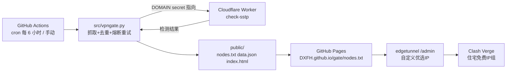

# 01 设计架构

目标：用 GitHub Actions 定时抓取 VPN Gate SSTP 节点，经 Cloudflare Worker 校验可用性，把结果发布成 GitHub Pages 上的 `nodes.txt`，供现有 edgetunnel 后台的「自定义优选 IP/域名」引用。Clash Verge 的 YAML 不需要改。

## 数据流

## 组件

| 组件 | 位置 | 说明 |
|---|---|---|
| 抓取与检测脚本 | `src/vpngate.py` | 来自 hezhanleiok/gate，已加入重试、熔断、不崩溃退出 |
| 工作流 | `.github/workflows/vpngate.yml` | 定时 + 手动触发，使用 `secrets.DOMAIN` |
| 检测 Worker | `worker/_worker.js` | 固定自 lsh8848/cm-Workers-CheckSocks5，由 Pulumi 部署 |
| IaC | `pulumi/index.ts` | Worker、workers.dev 子域、GitHub 仓库、Actions Secret `DOMAIN` |
| 测试 | `tests/` | mock Worker + 8 个故障注入用例 |

## 设计要点

- **凭据解耦**：Worker 完整检测地址只存在于 GitHub Secret `DOMAIN` 与 Pulumi 加密状态中，代码和产物里没有明文。令牌放在 WSL 的 `~/*.env`，不进仓库。
- **失败不污染发布**：只有本轮产生有效结果才输出 `publish=true`；否则 Pages 保持上一次部署，`nodes.txt` 不会被清空。
- **权限**：工作流声明 `pages: write`、`id-token: write`，并通过 API 把仓库 Workflow Permissions 设为 read/write。Pages 使用 Actions 作为来源（`build_type=workflow`），所以不需要 `/public` 目录推送。